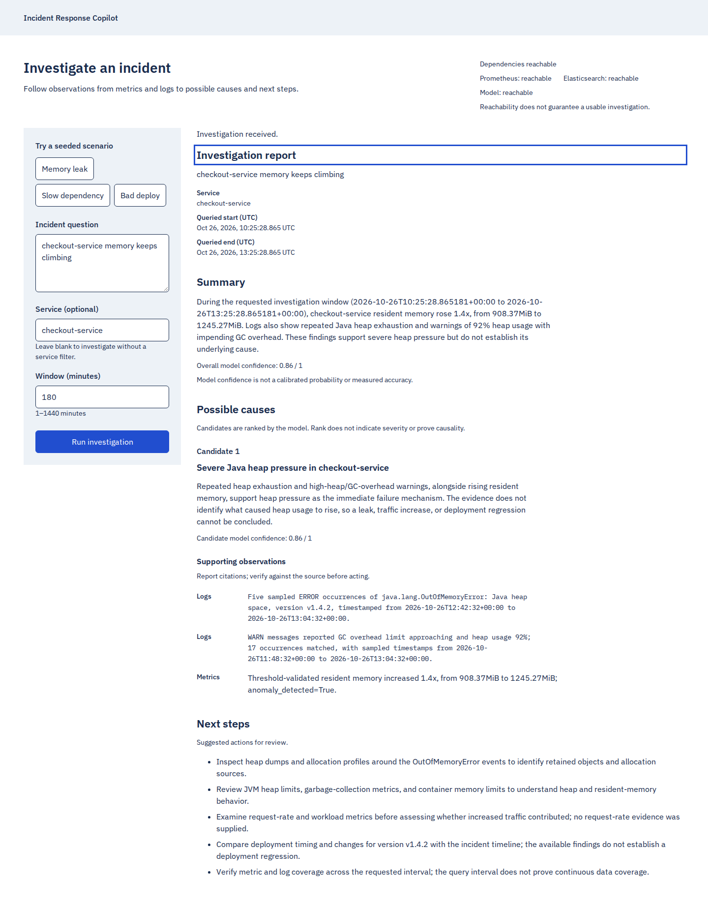
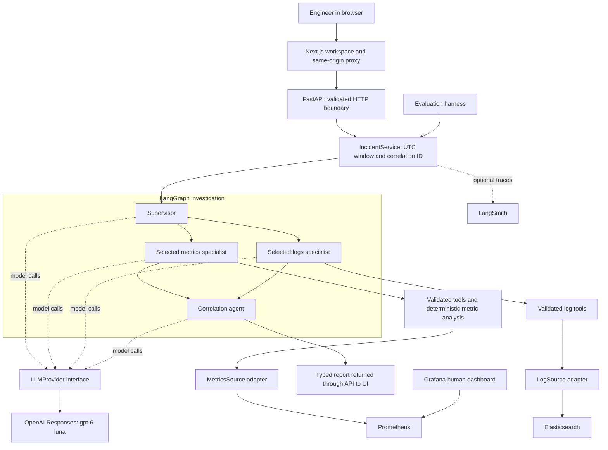

# Incident Response Copilot

Turn a service symptom into an evidence-backed investigation brief. Built for
on-call engineers reviewing application metrics and logs, Incident Response
Copilot queries Prometheus and Elasticsearch, proposes ranked causes, and lists
checks an engineer can use to test those hypotheses.

[Watch the 56-second demo](docs/media/2026-10-26/demo.html)
with captions and a descriptive transcript. The recording shows real OpenAI
investigations of synthetic incidents; waiting is shortened in the edit.



1. Describe the symptom, optionally select a service, and choose a time window;
   three seeded examples provide a starting point.
2. A LangGraph supervisor selects metrics and logs specialists, which collect
   observations through validated tools within the same server-owned interval.
3. Review the report's summary, ranked candidates, supporting observations and
   next steps in the Next.js workspace or through the FastAPI API. Causes remain
   hypotheses, and model confidence is uncalibrated.

The engineering focus is explicit boundaries: deterministic metric calculations,
bounded model/tool execution, typed reports and runtime browser validation.
**OpenAI Responses with `gpt-6-luna`, reasoning effort `none`, is the sole
production provider**, behind an extensible interface with no automatic fallback.
The application is a local demonstration using synthetic telemetry; public
hosting, authentication and persistent report history are outside its scope.

## Build and run

Run commands from a fresh checkout's repository root. Docker setup needs
Python **3.12 or 3.13** (default 3.12.14), [uv **0.12.5**](https://docs.astral.sh/uv/),
Docker Engine with Compose v2 supporting `up --wait`, GNU Make, curl, and an
OpenAI API key with access and quota for `gpt-6-luna`. Host frontend development
and checks additionally need **Node 22.18+ and npm 10+**.
Ports **3001, 8000, 3000, 9090 and 9200** must be free.

```bash
# On a new checkout only; preserve an existing private .env.
cp .env.example .env
# Edit .env: set OPENAI_API_KEY and leave LANGSMITH_TRACING=false.
make install          # locked backend/dev dependencies; also used by the seeder
make docker-up        # build and start all five services; wait for readiness
make seed             # fresh synthetic metrics/logs; restart Prometheus
curl --fail http://localhost:8000/health
# Open http://localhost:3001
```

A healthy response has `status: "ok"` and true `prometheus`, `elasticsearch`,
and `llm` dependency fields. The OpenAI probe checks model metadata within three
seconds; it does not establish inference permission or reserve quota. If a host
port is occupied, use the Compose override described in the
[operation guide](docs/full-stack-operation.md) and substitute that published
port in curl commands. Internal service URLs stay unchanged.
Docker receives backend `.env` values at container creation; run `make docker-up`
after changing them.

| Service | Local URL | Purpose |
|---|---|---|
| Next.js | http://localhost:3001 | Investigation workspace |
| FastAPI | http://localhost:8000/docs | Interactive API documentation |
| Prometheus | http://localhost:9090 | Seeded time series and PromQL |
| Grafana | http://localhost:3000 | Provisioned Incident Overview dashboard |
| Elasticsearch | http://localhost:9200 | Synthetic application logs |

Choose **Memory leak**, **Slow dependency**, or **Bad deploy**; review the filled
question, service and **180-minute** window, then click **Run investigation**.
The returned report shows the queried UTC endpoints, summary, ranked candidates,
observations, uncalibrated model confidence and proposed next steps. Candidate
rank does not measure incident severity. **Stop waiting** cancels browser I/O;
backend work may continue. Failures offer an explicit retry.

Live investigations incur OpenAI usage. Allow roughly 65 seconds between demo
submissions to reduce quota pressure; quota availability is not guaranteed.
Seed shortly before a demo: every investigation ends **now**, while generated
history stays fixed. `make seed` recreates the synthetic log index and adds fresh
metric blocks. For an explicit clean reset, inspect `Makefile` first:
`make demo-reset` **deletes generated Prometheus data** and restarts/reseeds the
stack. Ordinary startup and shutdown preserve that data; no volume deletion is
needed.

```bash
make docker-down      # stop/remove stack containers and network, preserve data
```

The stack uses unauthenticated Elasticsearch and anonymous Grafana viewing for
local synthetic telemetry. Full command details and troubleshooting are in the
[operation guide](docs/full-stack-operation.md).

### API usage

```bash
curl --fail-with-body http://localhost:8000/api/v1/investigations \
  -H 'Content-Type: application/json' \
  -d '{"query":"checkout-service memory keeps climbing","service":"checkout-service","minutes_back":180}'
```

The response contains `summary`, `likely_causes` (title, rationale, confidence,
supporting evidence), `next_steps`, `confidence`, and `investigation_window`.
[An actual captured response](docs/validation/2026-10-26-evaluation/browser-demo.json)
is retained with its request, status and timing. Window metadata is server-owned.
`service` is optional; `minutes_back` accepts 1–1440. Invalid requests return 422;
a failed investigation returns 503 with a safe message.

### Host development

Stop containerized app/frontend instances before using the same host ports.
With the root `.env` configured as above:

```bash
make install-all                 # locked Python and npm installs, sequentially
make docker-observability-up     # Prometheus, Elasticsearch and Grafana only
make seed
make serve                       # terminal 1: FastAPI on 8000
```

In a second terminal, run `make frontend-dev` and open <http://localhost:3001>.
Stop host servers with Ctrl+C, then `make docker-down` to stop observability.
The sole frontend setting is server-only `INCIDENT_COPILOT_BACKEND_ORIGIN`
(default `http://127.0.0.1:8000`); production rewrites require a rebuild when it
changes. Never put model/tracing credentials in frontend configuration. See the
[frontend guide](frontend/README.md) for production previews and browser checks.

## Seeded scenarios

`make seed` generates three hours of aligned metrics and logs. Metrics are backfilled
as TSDB blocks using `promtool`; Elasticsearch receives synthetic application logs,
including GC, OOM, and restart evidence for the memory-leak scenario. Grafana exposes
latency, error ratio, application memory, and CPU.

| Scenario | Investigation target | Seeded culprit | Observations |
|---|---|---|---|
| Memory leak | `checkout-service` | `checkout-service` | Memory climbs, restarts reset it, OOM/GC logs appear |
| Slow dependency | `payment-service` | `fraud-api` | Dependency latency rises before the caller; timeout warnings |
| Bad deploy | `cart-service` | `cart-service` | 5xx rises to about 15% around version `v1.4.2` → `v1.5.0` |

These are known synthetic scenarios, not production incidents. The presence of a
seeded causal pattern does not establish that a generated report recovered it.

## System design



The browser talks only to FastAPI through Next.js same-origin rewrites. FastAPI
and the evaluation harness share `composition.build_collaborators`: provider
selection lives in `llm.factory`, while `IncidentService` orchestrates a compiled
graph without constructing clients. FastAPI's lifespan owns serving resources
and closes them at shutdown. Grafana queries Prometheus for human inspection.

The graph is acyclic: supervisor → selected specialists → correlation. Selected
specialists can run concurrently; typed state reducers merge their findings and
errors. Tools validate arguments and call narrow connector interfaces. The
requested interval travels through runtime tool configuration, so a model's
chosen duration cannot override it.

Curated metric analysis computes trends and thresholds deterministically before the
model interprets them. Raw PromQL findings are marked as not threshold-validated.
Correlation receives the selected specialists' findings, collection errors, and
the exact window. Non-anomalous findings remain available for interpretation.
Pydantic drops hollow candidates and sorts the remaining causes by model
confidence; the browser validates unknown JSON before rendering. These checks
establish report structure, not the truth of a diagnosis.

| Engineering boundary | Behavior |
|---|---|
| Provider abstraction | Agents and services depend on `LLMProvider`; only the factory selects the OpenAI adapter. The fake provider is test-only. [Adapter and client ownership rules](docs/provider-adapters.md) define extension points. |
| Bounded execution | Default two model/tool rounds per specialist, up to three structured-output attempts within a 60-second operation deadline, and a 240-second cooperative investigation budget. A round can contain multiple tool calls; the round cap is not a per-call count. SDK transport retries are disabled. |
| Exact time scope | The service creates one UTC interval, injects it into every temporal tool and overwrites model-authored report window metadata. The UI displays those exact endpoints. Query scope does not establish incident onset. |
| Observability | Structured runtime events carry investigation correlation IDs. Optional LangSmith traces capture graph/model/tool activity; the application also runs with tracing disabled and no tracing credentials. |
| Evidence boundaries | Typed metrics retain units, deltas and threshold flags; logs retain distinct messages and dependency names. Citations and confidence do not prove causal order or a mechanism. |

### Technology stack

| Layer | Technology |
|---|---|
| Language and packaging | Python 3.12/3.13, uv, Hatchling |
| Orchestration | LangGraph, LangChain Core |
| API and validation | FastAPI, Pydantic v2, pydantic-settings |
| Model provider | langchain-openai and OpenAI Responses behind `LLMProvider` |
| Data and dashboards | Prometheus, Elasticsearch 8.19, Grafana |
| UI | Next.js App Router, React, TypeScript |
| Observability | structlog, optional LangSmith |
| Quality checks | pytest, Ruff, Black, strict mypy |
| Deployment and demo capture | Docker Compose; Playwright and FFmpeg for validation/media |

### Repository structure

```text
backend/
├── src/incident_copilot/
│   ├── config/           # validated runtime settings
│   ├── models/           # typed reports, findings and UTC windows
│   ├── analysis/         # deterministic metric analysis and evidence rendering
│   ├── connectors/       # MetricsSource/LogSource interfaces and adapters
│   ├── tools/            # validated queries and fixed-window propagation
│   ├── llm/              # provider interface, OpenAI adapter, test-only fake
│   ├── agents/           # supervisor, specialists, correlation and tool loop
│   ├── services/         # investigation orchestration and deadlines
│   ├── api/              # HTTP schemas, health and investigation routes
│   ├── demo/             # pure scenario definitions and data rendering
│   ├── evaluation/       # scenario harness and service-mention scorer
│   ├── utils/            # tracing, structured logging and domain errors
│   ├── composition.py    # shared dependency construction
│   └── main.py           # FastAPI application and resource lifecycle
├── scripts/              # seeding, contract export and validation
├── tests/                # offline unit, typing and live integration checks
├── pyproject.toml        # Python package and static-tool configuration
├── uv.lock               # locked backend/dev dependencies
└── Dockerfile            # repository-root build context
frontend/
├── src/
│   ├── app/              # server-rendered route, layout, fonts and styles
│   ├── components/       # shared static shell
│   ├── features/investigations/ # interactive health, form and report leaves
│   └── lib/api/          # transport, runtime validation and generated contract
├── tests/
│   ├── components/       # React rendering and interaction checks
│   ├── e2e/              # Chromium fixtures, responsive and timeout checks
│   └── *.test.*          # Node contract, transport and configuration checks
├── package-lock.json     # locked frontend dependencies
└── Dockerfile            # standalone Next.js production image
docker/                   # observability configuration and Grafana provisioning
docs/                     # operation, contracts, validation and demo media
Makefile                  # root install/run/check/seed commands
docker-compose.yml        # five-service local application
pytest.ini                # root/backend test discovery
```

## Configuration and failure behavior

[`.env.example`](.env.example) lists the current OpenAI and shared settings. Never put
keys in tracked source. Source checkout and editable-install commands load the
repository-root `.env`, including when launched from `backend/` or another working
directory. A `backend/.env` or caller-directory `.env` is ignored. Process environment
values override file values.

For an installed wheel, supply process variables or set `INCIDENT_COPILOT_ENV_FILE`
to an absolute dotenv path **before starting Python**. This selector also overrides
the checkout default; an empty value disables dotenv loading. The selection is
fixed when the settings module is imported. Missing dotenv files leave process
variables and defaults in effect. Docker Compose injects the root `.env` as process
variables, with its service URLs taking precedence; the file is excluded from the
image. Offline unit tests disable dotenv loading and use isolated dummy settings.
Python callers can also use `Settings(_env_file=None)` to disable file loading.

The default configuration is:

| Setting | Default |
|---|---|
| `LLM_PROVIDER` | `openai` |
| `OPENAI_API_KEY` | Required; no default |
| `OPENAI_MODEL` | `gpt-6-luna` (only accepted value) |
| `LLM_OPERATION_TIMEOUT_SECONDS` | `60` per text/tool call or complete structured generation including repairs |
| `LLM_MAX_OUTPUT_TOKENS` | `4096` per request |
| `LLM_MAX_STRUCTURED_ATTEMPTS` | `3`, including the initial generation |
| `MAX_TOOL_ROUNDS` | `2` per specialist |
| `LANGSMITH_TRACING` | `false` |

A missing, empty, or whitespace-only OpenAI key fails configuration early.
Model substitutions and retired provider selections are rejected; the fake provider
is test-only and cannot be selected by configuration. Obsolete provider and fallback
variables are ignored and cannot activate another provider. Process variables override
the root file's `OPENAI_API_KEY` and `OPENAI_MODEL`. OpenAI keys use Pydantic
`SecretStr`; settings validation messages hide input values. SDK retries are disabled.
Upstream authentication, quota/rate-limit, connection, timeout, invalid-request, and
service failures become fixed domain errors without forwarding provider payloads.
See [provider boundaries and failure behavior](docs/provider-adapters.md) for accepted
limit ranges, request bounds, redaction, health semantics, and client ownership.

Provider operation deadlines and bounded structured-output repair remain enforced.
If the provider cannot produce a report, the API returns 503 and the UI displays
the error.

Provider deadlines apply to individual operations, within the service deadline.
The browser has a **300-second total fetch/body budget**; proxy and backend budgets
are documented in [timeout coordination](docs/investigation-timeouts.md). Aborting
a browser request does not guarantee server cancellation. The UI handles disconnected
APIs, JSON and non-JSON errors, malformed reports, and health-response failures.

To enable tracing, set `LANGSMITH_TRACING=true`, `LANGSMITH_API_KEY`, and optionally
`LANGSMITH_PROJECT`; restart the application. Both modern and legacy SDK flags are
configured together. Tracing configuration is process-wide, not a per-request
switch. Disabled operation was tested without a tracing key in settings, including
inherited enabled SDK flags.

## Measured synthetic evaluation

On **October 26, 2026**, OpenAI Responses **`gpt-6-luna`**, reasoning effort
**`none`**, tracing disabled, completed a fixed nine-attempt series: three
attempts per scenario against freshly seeded data, each with a server-owned
180-minute window. All nine reports and both score misses are retained; no
replacement attempts were made. The [frozen method](docs/validation/2026-10-26-evaluation/method.md)
and [runtime/lock versions](docs/validation/2026-10-26-evaluation/environment.md)
define the run.

| Scenario | Expected-service mentions | Reports | Errors | Latency n | Mean s | Median s | Range s |
|---|---:|---:|---:|---:|---:|---:|---:|
| Bad deploy | 3/3 (100%) | 3 | 0 | 3 | 40.522 | 40.820 | 38.616–42.131 |
| Memory leak | 1/3 (33.3%) | 3 | 0 | 3 | 26.939 | 25.876 | 25.707–29.235 |
| Slow dependency | 3/3 (100%) | 3 | 0 | 3 | 23.888 | 23.154 | 22.248–26.263 |
| **Overall** | **7/9 (77.8%)** | **9** | **0** | **9** | **30.450** | **26.263** | **22.248–42.131** |

Latency measures direct `IncidentService.investigate` calls, excluding setup,
seeding and eight 15-second pacing gaps. All calls delivered reports, so delivered
latency equals all-call latency; failed-call latency has n=0 and no defined
statistics. Total series wall time was 394.150 seconds, including 120 seconds
of planned pacing and recorder overhead. These are local synthetic observations,
not a general latency or throughput estimate.

**The score measures mentions, not root-cause accuracy.** The unchanged scorer
checks a case-insensitive expected-service substring in the first cause's title,
rationale and evidence details. Summary-only mentions fail; incidental or negated
mentions can pass, and identifier aliases can fail. The two memory misses name
`checkout-service` in their summaries but omit it from scored fields. Dependency
reports name `fraud-api` without establishing that it degraded before its caller.
Heap retention and deploy attribution remain hypotheses where evidence is absent.
See the [nine-report qualitative review](docs/validation/2026-10-26-evaluation/qualitative-review.md)
and [per-attempt results](docs/validation/2026-10-26-evaluation/results.json).

Reproduce the saved scores offline, without new model calls:

```bash
INCIDENT_COPILOT_ENV_FILE='' .venv/bin/python docs/validation/2026-10-26-evaluation/rescore.py --check
```

To deliberately repeat the paid nine-attempt protocol, start the stack, seed
immediately beforehand, and choose an output directory that does not exist:

```bash
make seed
LANGSMITH_TRACING=false timeout 2400 .venv/bin/python \
  docs/validation/2026-10-26-evaluation/collect.py /tmp/incident-eval-new --live
```

The collector preserves every attempt, including errors. It uses the same scorer,
scenarios and production composition as `make eval`, adding fixed pacing and
artifact capture. The [collection record](docs/validation/2026-10-26-evaluation/README.md)
contains exact environment overrides and commands used for the published run.
The demo's three additional browser investigations are a separate population:
[HTTP/render timings and media provenance](docs/media/2026-10-26/README.md).
The edited video's duration is not investigation latency.

## Validation and tests

The [current evidence index](docs/validation/README.md) links functional checks,
reproduction methods, saved reports and media provenance. Scoring limitations and
qualitative findings accompany the evidence. Model confidence is uncalibrated;
a service mention does not prove root cause.

Tests focus on behavior at boundaries: fixed temporal intervals across tools,
parallel finding/error merging, malformed tool recovery, report filtering and
ranking, resource cleanup and provider failure redaction. Offline backend cases
use fake providers, mocked transports and isolated settings without Docker,
network requests or the private dotenv. Frontend cases exercise runtime JSON
validation, request states, safe failures and accessible form/report interaction.
Chromium checks use controlled API fixtures for keyboard, responsive and zoom
behavior; live connector/provider checks are explicit integration commands.
Fixture success is distinct from a real model investigation.

## Development checks

`make install` installs the locked backend/dev set into the root `.venv/`.
Use `VENV=/absolute/path` and optionally `PYTHON=3.13` for an isolated install,
then pass the same `VENV` to checks. From `backend/`, set
`UV_PROJECT_ENVIRONMENT` to the absolute root `.venv/` path before syncing.
Dependency changes require an intentional `uv lock --project backend` and a
manifest/lock commit together. Frontend installs use `frontend/package-lock.json`.

```bash
make lint
make test                        # offline backend; no live credentials or Docker
make format-check
make install-frontend
make frontend-test frontend-lint frontend-format-check frontend-typecheck
make api-contract-check
make frontend-build
# Install matching Chromium once before browser checks:
(cd frontend && npx playwright install chromium)
make frontend-e2e                # leave port 3001 free; controlled API fixtures
.venv/bin/python backend/scripts/validate_provider_failures.py
```

Run build and type generation sequentially; both write `frontend/.next/`.
`make check` combines sequential static/unit/contract/build checks, excluding
live integration and Chromium. Generated API types are checked for schema drift;
network responses also pass runtime validation. Browser artifacts stay in
`frontend/test-results/`.

Live checks need freshly seeded dependencies and a configured OpenAI key:

```bash
INCIDENT_COPILOT_SCENARIO_DELAY_SECONDS=65 make test-integration
# Optional tracing check; use a new output directory for each run.
.venv/bin/python backend/scripts/validate_langsmith.py \
  --mode disabled --output /tmp/incident-tracing-disabled
```

Use `--mode enabled` with LangSmith credentials to verify remote trace delivery.
These commands make live requests and are separate from offline CI. Relative
backend recorder outputs resolve from the repository root; absolute paths stay
absolute. Evaluation reproduction is documented with the measured results above.
