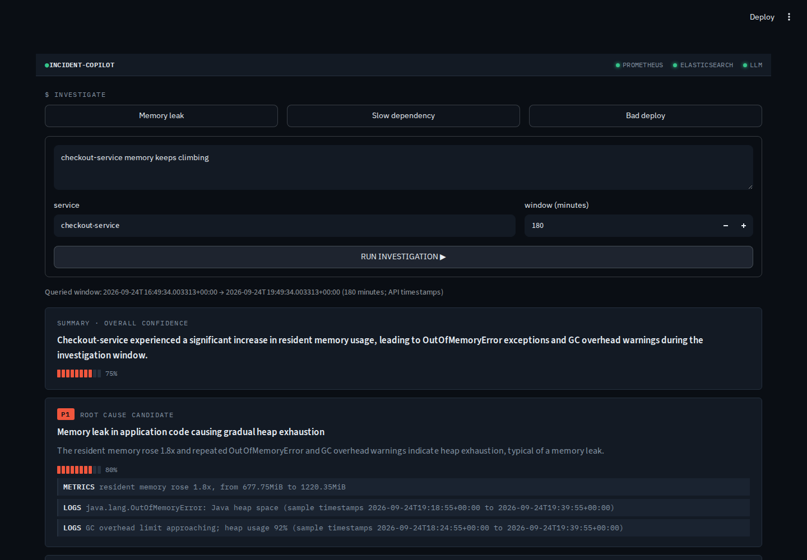
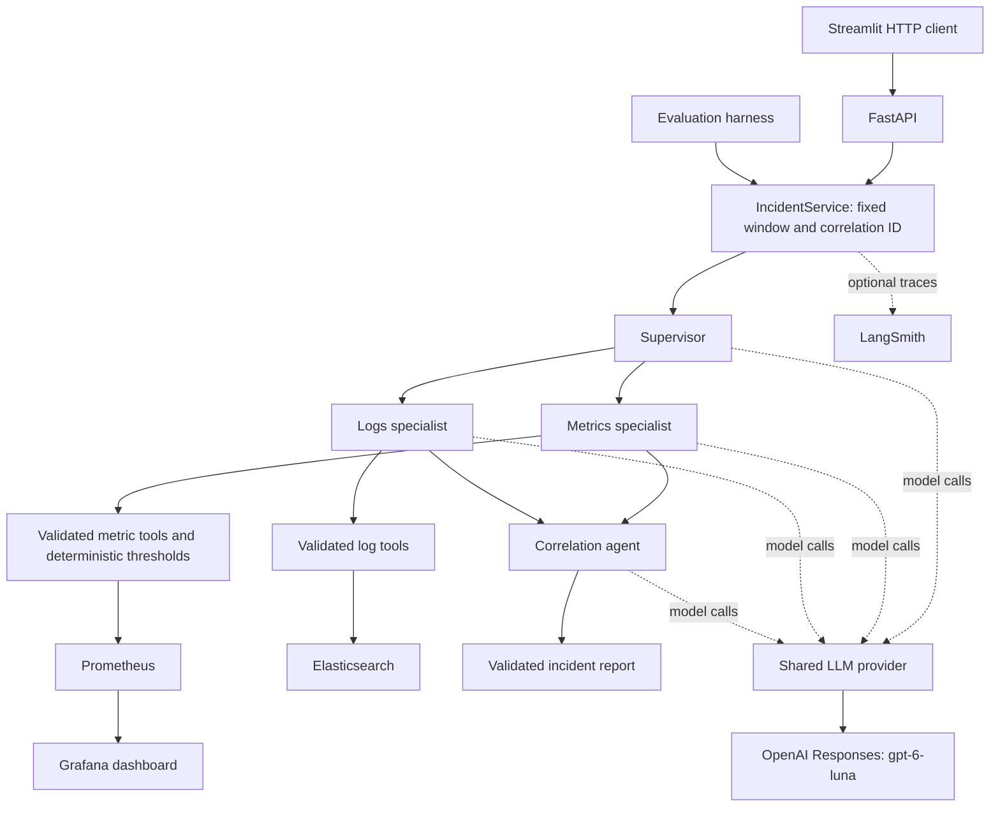
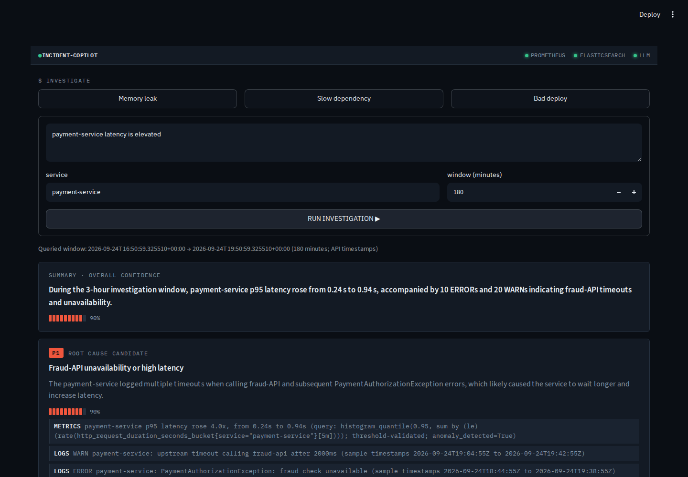
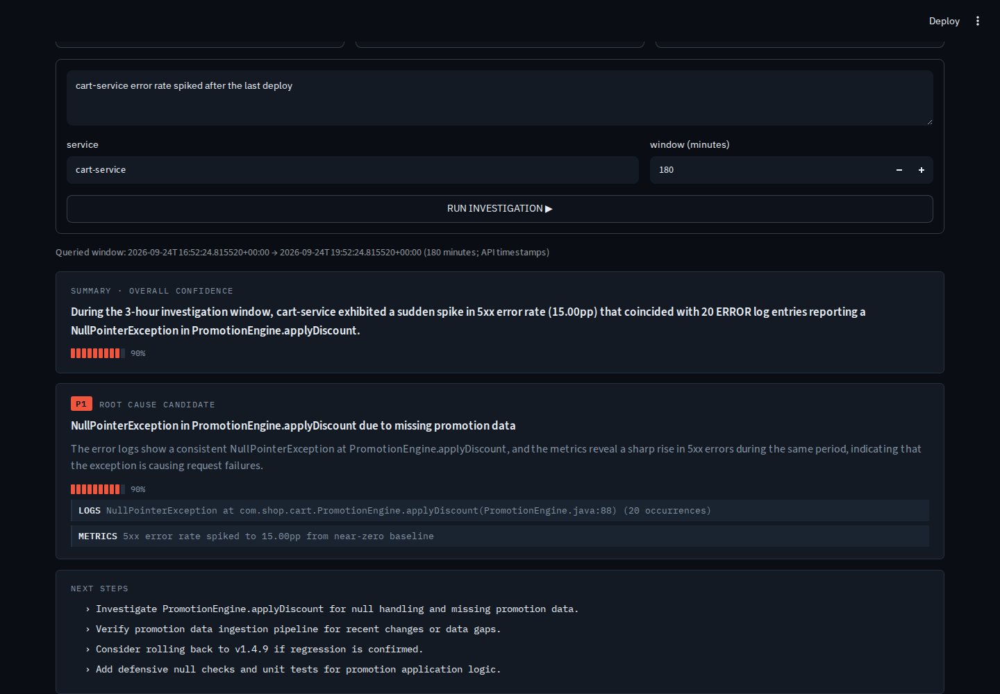

# Incident Response Copilot

Current local Docker and host commands are documented in the
[full-stack operation guide](docs/full-stack-operation.md).

An agentic AI system that helps engineers investigate production incidents faster. It turns a service symptom into a structured
report using Prometheus metrics and Elasticsearch logs. A LangGraph supervisor
routes work to metrics and logs specialists; a correlation agent proposes ranked
causes, cites observations, and suggests follow-up checks. Engineers can investigate
through a FastAPI endpoint or a Streamlit console.

**OpenAI Responses with `gpt-6-luna` is the only production provider**, with reasoning
effort `none` and no automatic fallback. Configuration, serialized requests, bounded
health probing, and normalized failures have offline coverage. A
[live adapter smoke check](docs/validation/2026-10-22-openai-live-smoke/README.md)
verified text, structured output, and tool continuation with this exact model and
reasoning setting. Application provider-client cleanup remains pending. The recorded
demo and measured results below use the previous Groq/Ollama configuration and do
not validate the current application.

[Watch/download the 55-second recorded demo](docs/media/streamlit-demo.mp4)



## Build and run

Prerequisites: Python **3.12 or 3.13**, [uv 0.12.5](https://docs.astral.sh/uv/), Docker Engine with
Compose, and an OpenAI API key. Commands below run from the repository root.

```bash
cp .env.example .env
# Edit .env and set OPENAI_API_KEY. Leave LANGSMITH_TRACING=false for this walkthrough.

make install-ui       # locked backend, development tools, and existing UI

make docker-app-up   # build FastAPI and start all four services
make seed            # load fresh synthetic metrics/logs; restart Prometheus
curl --fail http://localhost:8000/health
make streamlit       # host UI on http://localhost:8501
```

`/health` reports Prometheus, Elasticsearch, and `llm` dependency booleans, with
overall status `ok` only when all probes succeed. The provider-owned OpenAI probe
retrieves the configured model's metadata within a three-second deadline. A true
`llm` result establishes metadata access, not inference permission or available
quota. The full OpenAI walkthrough still awaits live validation.
The UI runs on the host; FastAPI and the three supporting services run in Docker.
Docker receives `.env` configuration at container creation, so rerun
`make docker-app-up` after changing it.

The backend now lives in `backend/`; seeding and evaluation/validation paths
resolve from the repository root. The live walkthrough above has not been
revalidated for this layout.

| Service | Local URL | Purpose |
|---|---|---|
| Streamlit | http://localhost:8501 | Investigation form and report cards |
| FastAPI | http://localhost:8000/docs | Interactive API documentation |
| Prometheus | http://localhost:9090 | Seeded time series and PromQL |
| Grafana | http://localhost:3000 | Provisioned Incident Overview dashboard |
| Elasticsearch | http://localhost:9200 | Synthetic application logs |

Choose **Memory leak**, **Slow dependency**, or **Bad deploy**, then click
**RUN INVESTIGATION**. Each example selects its target service and a 180-minute
window. Reports display the API's authoritative start/end timestamps, a summary,
ranked candidates, evidence, model confidence, and next steps. P1/P2/P3 indicate
candidate rank, not measured incident severity. Confidence is not calibrated.

Allow roughly 65 seconds between live demo investigations to reduce quota pressure;
this does not guarantee quota availability. Health checks do not reserve cloud quota.

Seed shortly before a demo: investigations query a window ending **now**, while
seeded history stays fixed. `make seed` replaces the synthetic log index and adds
fresh metric blocks. For a clean demo reset, `make demo-reset` replaces generated
data and starts the supporting services; follow it with `make docker-app-up` to
restore the API. These commands affect this project's demo data.

Stop the UI with Ctrl+C and the Docker stack with `make docker-down`. Existing
Docker volumes survive normal shutdown.
The demo uses unauthenticated Elasticsearch and anonymous Grafana viewing and is
intended for local synthetic data.

### API usage

```bash
curl --fail-with-body http://localhost:8000/api/v1/investigations \
  -H 'Content-Type: application/json' \
  -d '{"query":"checkout-service memory keeps climbing","service":"checkout-service","minutes_back":180}'
```

The response contains `summary`, `likely_causes` (title, rationale, confidence,
supporting evidence), `next_steps`, `confidence`, and `investigation_window`.
[An actual captured response](docs/validation/2026-09-24-streamlit/browser/memory_leak.json)
is retained with its request, status, and timing. The window metadata comes from
the service, independently of model-written prose. `service` is optional and
`minutes_back` accepts 1–1440. Invalid requests return HTTP 422; an investigation
that cannot produce a report returns HTTP 503.

To run FastAPI on the host instead of in Docker, start the supporting services with
`make docker-up`, seed, and use `make serve`. Port 8000 must be free. Set
`INCIDENT_COPILOT_API_URL` in the UI process environment to use a different API:

```bash
INCIDENT_COPILOT_API_URL=http://localhost:8000 make streamlit
```

## Seeded scenarios

`make seed` generates three hours of aligned metrics and logs. Metrics are backfilled
as TSDB blocks using `promtool`; Elasticsearch receives synthetic application logs,
including GC, OOM, and restart evidence for the memory-leak scenario. Grafana exposes
latency, error ratio, application memory, and CPU.

| Scenario | Investigation target | Seeded culprit | Observations |
|---|---|---|---|
| Memory leak | `checkout-service` | `checkout-service` | Memory climbs, restarts reset it, OOM/GC logs appear |
| Slow dependency | `payment-service` | `fraud-api` | Dependency latency rises before the caller; timeout warnings |
| Bad deploy | `cart-service` | `cart-service` | 5xx rises to about 15% around version `v1.4.2` → `v1.5.0` |

These are known synthetic scenarios, not production incidents. The presence of a
seeded causal pattern does not establish that a generated report recovered it.

## System design



The graph is acyclic: supervisor → selected specialists → correlation. Specialists
can run concurrently, and each has bounded tool rounds. Tools validate arguments
and call connector interfaces; agents do not access raw data clients directly.
The requested interval travels through runtime tool configuration, so a model's
chosen duration cannot override it.

Curated metric analysis computes trends and thresholds deterministically before the
model interprets them. Raw PromQL findings are marked as not threshold-validated.
Correlation receives both specialists' findings, collection errors, and the exact
window. Pydantic validates the report shape and ranks nonempty, evidenced causes;
it does **not** verify that cited evidence proves a diagnosis.

### Technology stack

| Layer | Technology |
|---|---|
| Language and packaging | Python 3.12/3.13, uv, Hatchling |
| Orchestration | LangGraph, LangChain Core |
| API and validation | FastAPI, Pydantic v2, pydantic-settings |
| Model provider | langchain-openai and OpenAI Responses behind `LLMProvider` |
| Data and dashboards | Prometheus, Elasticsearch 8.13, Grafana |
| UI | Streamlit, HTTPX |
| Observability | structlog, optional LangSmith |
| Quality checks | pytest, Ruff, Black, strict mypy |
| Deployment and demo capture | Docker Compose; Playwright and FFmpeg for validation/media |

### Package structure

```text
backend/src/incident_copilot/
├── config/           # environment-driven settings
├── models/           # reports, findings, metrics, logs, windows
├── analysis/         # deterministic trends and evidence rendering
├── connectors/       # Prometheus and Elasticsearch adapters
├── tools/            # validated tools and fixed-window propagation
├── llm/              # OpenAI adapter, test-only fake, JSON repair
├── agents/           # supervisor, specialists, correlation, compiled graph
├── services/         # investigation use case and authoritative metadata
├── api/              # HTTP schemas, health and investigation routes
├── demo/             # scenario curves and synthetic data rendering
├── evaluation/       # scenario harness and service-mention scorer
├── utils/            # tracing, logging, exceptions
├── composition.py    # shared construction for API and evaluation
└── main.py           # FastAPI entry point
streamlit_app/             # independent HTTP client, page, styles
backend/scripts/           # seeding and backend validation recorders
backend/tests/unit/        # offline tests with fake/stub dependencies
backend/tests/integration/ # live stack and deployed API checks
backend/pyproject.toml     # Python package and static-tool configuration
backend/Dockerfile         # built with the repository root as context
pytest.ini                 # shared root/backend test collection configuration
scripts/                   # existing Streamlit validation recorder
docker/                    # service configuration and Grafana provisioning
docs/validation/           # reports, measurements, commands, screenshots
```

## Configuration and failure behavior

[`.env.example`](.env.example) lists the current OpenAI and shared settings. Never put
keys in tracked source. Source checkout and editable-install commands load the
repository-root `.env`, including when launched from `backend/` or another working
directory. A `backend/.env` or caller-directory `.env` is ignored. Process environment
values override file values.

For an installed wheel, supply process variables or set `INCIDENT_COPILOT_ENV_FILE`
to an absolute dotenv path **before starting Python**. This selector also overrides
the checkout default; an empty value disables dotenv loading. The selection is
fixed when the settings module is imported. Missing dotenv files leave process
variables and defaults in effect. Docker Compose injects the root `.env` as process
variables, with its service URLs taking precedence; the file is excluded from the
image. Offline unit tests disable dotenv loading and use isolated dummy settings.
Python callers can also use `Settings(_env_file=None)` to disable file loading.

The default configuration is:

| Setting | Default |
|---|---|
| `LLM_PROVIDER` | `openai` |
| `OPENAI_API_KEY` | Required; no default |
| `OPENAI_MODEL` | `gpt-6-luna` (only accepted value) |
| `LLM_OPERATION_TIMEOUT_SECONDS` | `60` per text/tool call or complete structured generation including repairs |
| `LLM_MAX_OUTPUT_TOKENS` | `4096` per request |
| `LLM_MAX_STRUCTURED_ATTEMPTS` | `3`, including the initial generation |
| `MAX_TOOL_ROUNDS` | `2` per specialist |
| `LANGSMITH_TRACING` | `false` |

A missing, empty, or whitespace-only OpenAI key fails configuration early.
Model substitutions and retired provider selections are rejected; the fake provider
is test-only and cannot be selected by configuration. Obsolete provider and fallback
variables are ignored and cannot activate another provider. Process variables override
the root file's `OPENAI_API_KEY` and `OPENAI_MODEL`. OpenAI keys use Pydantic
`SecretStr`; settings validation messages hide input values. SDK retries are disabled.
Upstream authentication, quota/rate-limit, connection, timeout, invalid-request, and
service failures become fixed domain errors without forwarding provider payloads.
See [provider boundaries and failure behavior](docs/provider-adapters.md) for accepted
limit ranges, request bounds, redaction, health semantics, and client ownership.

OpenAI is the only production provider. The backend has no host RAM gate,
model-loading probe, local inference lock, or local context/keep-alive setting.
Provider operation deadlines and bounded structured-output repair remain enforced.
If the provider cannot produce a report, the API returns 503 and the UI displays
the error.

Provider deadlines apply to individual operations. The UI has a **300-second HTTPX
network-inactivity timeout**, not a total server deadline. A timed-out investigation
may still run on the server. The UI handles disconnected APIs, JSON and non-JSON
errors, malformed reports, and health-response failures.

To enable tracing, set `LANGSMITH_TRACING=true`, `LANGSMITH_API_KEY`, and optionally
`LANGSMITH_PROJECT`; restart the application. Both modern and legacy SDK flags are
configured together. Tracing configuration is process-wide, not a per-request
switch. Disabled operation was tested without a tracing key in settings, including
inherited enabled SDK flags.

## Historical measured results

These records describe the retired provider configuration and earlier application
revision. They are preserved with their original measurements and media; they do
not measure current OpenAI performance or verify the current deployed stack.

### Repeated evaluation: 2026-09-23

**Method:** three attempts per scenario using host `IncidentService` calls against
real Groq `openai/gpt-oss-20b` and Docker data sources, tracing disabled, temperature
0, a 180-minute window, and 65-second pacing. All nine attempts are retained,
including the failure. The scorer searches the **first cause's title, rationale,
and evidence** for a case-insensitive expected service-name substring. It excludes
the summary, later causes, and next steps. **This measures culprit-service mentions,
not verified causality or RCA accuracy.**

| Scenario | Mention matches | Score | Investigation errors | Mean latency |
|---|---:|---:|---:|---:|
| Bad deploy | 0/3 | 0% | 0 | 4.364 s |
| Memory leak | 2/3 | 66.7% | 0 | 5.857 s |
| Slow dependency | 2/3 | 66.7% | 1 | 6.374 s |
| **Overall** | **4/9** | **44.4%** | **1** | **5.532 s** |

Eight reports returned. Median latency was **5.586 s**, range **4.063–7.785 s**;
means include the failed attempt. Total pass time was **570.147 s**, including
pacing. These are service-call measurements, not HTTP or UI timings. The final
attempt hit Groq 429 during correlation and its fallback failed. No failed attempt
was replaced; the linked historical record retains the original failure details.

The preceding retained pass scored **5/9 (55.6%)**: bad deploy 2/3, memory leak 3/3,
slow dependency 0/3, with no investigation errors and 5.063 s mean latency. The two
small passes do not establish aggregate accuracy improvement. In the newer pass,
both returned dependency reports cited `fraud-api` evidence, and all eight returned
window fields matched the requested interval. The scorer missed a Unicode hyphen
in `checkout‑service` and service names appearing only in summaries.

[Latest results, full evidence, and reproduction commands](docs/validation/2026-09-23-evaluation/README.md)
· [Earlier baseline](docs/validation/2026-09-22-evaluation/README.md)

### Functional checks and UI demo: 2026-09-24

All three scenarios returned reports through desktop Chromium and Streamlit using
the live Docker API. Submit-to-render times were **6.440 s** (memory leak),
**6.410 s** (slow dependency), and **4.365 s** (bad deploy). The recording relay's
API calls took 5.419 s, 5.596 s, and 3.777 s respectively. These are one run per
scenario, not repeated latency benchmarks or additional accuracy measurements.

**12/12 browser cases passed**, including empty input, HTTP 503, non-JSON HTTP 502,
malformed reports/health, literal HTML rendering, connection loss, and timeout.
The timeout used a real stalled HTTP response and returned after **300.227 s**;
it was not shortened or simulated with a raised exception. Failure fixtures were
isolated from the real provider. A fresh browser session rendered successfully
after the timeout.

| Validation area | Retained result |
|---|---|
| Offline suite | 276 passed in 3.29 s; fresh dependency install: 276 in 4.46 s |
| Static checks | Ruff, strict mypy for backend/UI, Black, whitespace checks passed |
| Docker and API | Rebuilt and seeded; 12 live integration tests passed in 210.60 s, with full reports retained |
| LangSmith | 28 completed remote spans: all four agents, seven LLM calls, four tool calls; inputs/report matched local capture |
| Tracing disabled | Two successful investigations; no observed SDK HTTP calls or remote run IDs |
| Provider failures | Historical Groq/fallback failures returned 503; see the retained failure record |

[UI validation and commands](docs/validation/2026-09-24-streamlit/README.md)
· [LangSmith evidence](docs/validation/2026-09-23-langsmith/README.md)
· [Provider failure evidence](docs/validation/2026-09-22-fallback/README.md)

| Slow dependency screenshot | Bad deploy screenshot |
|---|---|
|  |  |

The [55.2-second MP4](docs/media/streamlit-demo.mp4) joins three real browser sessions
at original speed, omitting the inter-session quota waits. Reports were not replaced
or edited. Full requests, responses, displayed text, original videos, and screenshots
are retained in the UI validation record.

### Limits of these results

The dataset contains three synthetic scenarios. Reports still make unsupported
mechanism/configuration claims, sometimes confuse sample counts with totals, and
may suggest unobserved versions: the UI cart run proposed rollback to `v1.4.9`
although the seeded previous version is `v1.4.2`. Dependency timeout evidence does
not prove which service degraded first. Schema validation and evidence entries do
not establish factual grounding; model confidence is not an accuracy estimate.

Mobile/browser compatibility beyond desktop Chromium, tracing outages, and server
cancellation after UI timeout are unverified. Python dependencies are locked in
`backend/uv.lock`; several
container tags remain unpinned. Retained version/image records identify historical
tested environments. Model output and cloud quotas
can vary between runs.

## Development and reproduction

Install uv 0.12.5 before running `make install` (backend and development tools) or
`make install-ui` (also includes Streamlit). Both install from `backend/uv.lock`
into the root `.venv/` and fail if the lock does not match the manifest. They
retain unrelated installed packages when reusing a compatible environment; changing
the interpreter recreates it. The default interpreter is Python 3.12.14,
recorded in `backend/.python-version`; uv can download it if needed. To use
Python 3.13 in a separate environment, run
`make install-ui PYTHON=3.13 VENV=/tmp/incident-copilot-dev313`, then pass the same
`VENV` to root check commands.

From `backend/`, the equivalent install is
`UV_PROJECT_ENVIRONMENT="$(pwd)/../.venv" uv sync --locked --extra dev --extra ui --inexact`.
Without that environment selector, uv uses `backend/.venv/`, which the root Make
commands do not use. To intentionally change dependencies, edit the manifest,
run `uv lock --project backend`, review the lock diff, and rerun the checks below.
Commit the manifest and lock together. The Hatchling build backend and uv version
are pinned separately in the manifest because uv does not lock isolated build
dependencies in `uv.lock`.

```bash
make test                 # offline unit suite; no live providers or Docker required
make lint                 # Ruff and strict backend mypy
make format-check         # Black for backend, tests, and existing UI
.venv/bin/python backend/scripts/validate_provider_failures.py
.venv/bin/ruff check --config backend/pyproject.toml streamlit_app scripts/validate_streamlit.py
.venv/bin/mypy --config-file backend/pyproject.toml --strict streamlit_app

# Requires a running API, freshly seeded data, and a configured OpenAI key.
INCIDENT_COPILOT_SCENARIO_DELAY_SECONDS=65 make test-integration

# Retains all nine attempts, evidence, and timings.
# The output directory must not already exist.
LANGSMITH_TRACING=false .venv/bin/python -u backend/scripts/measure_evaluation.py \
  --output /tmp/incident-eval-repeat --delay-seconds 65

# Optional live validators; use new directories for each tracing/browser run.
.venv/bin/python backend/scripts/validate_langsmith.py \
  --mode disabled --output docs/validation/langsmith-repeat
.venv/bin/python scripts/validate_streamlit.py \
  --output docs/validation/browser-repeat --delay-seconds 65
```

Direct backend checks also work from `backend/`, for example
`../.venv/bin/pytest tests/unit` and `../.venv/bin/mypy --strict src`.
Root pytest commands select `pytest.ini`; its test paths and source path are
relative to the repository, including when invoked from `backend/`.
Checkout scripts import the relocated backend source directly. From `backend/`,
use `../.venv/bin/python scripts/measure_evaluation.py` with the same arguments.
For all three evaluation/validation recorders, relative `--output` paths resolve
from the repository root, including when launched elsewhere. Absolute paths such
as `/tmp/incident-eval-repeat` are preserved. Browser screenshots and videos stay
under the selected output directory's `media/`; documentation and published media
remain in root `docs/validation/` and `docs/media/`. Git provenance and Compose
commands also use the repository root.

The tracing validator accepts `--mode enabled` to check remote delivery with
configured LangSmith credentials. These are live commands, separate from the
offline suite. The OpenAI failure validator runs the real adapter/factory/API
tests with intercepted HTTP and synthetic credentials; it clears inherited
configuration and disables dotenv and remote tracing. It checks authentication,
quota/rate limits, timeouts, malformed output, recovery, redaction, and absence
of fallback or local-provider requests without Docker or live credentials.
It exits nonzero on failed cases, retired installed provider packages, or its
90-second deadline (`--timeout` accepts 1–300 seconds). Use a fresh locked
development install if an older environment still contains retired packages.
See the [validation evidence](docs/validation/2026-10-22-openai-only-failure-validator/README.md).

`make eval` runs the basic nine-attempt scorer without pacing or artifact capture.
The recorder above uses that same scorer and retains runtime/library versions,
reports, errors, and timings without host/process/container sampling. The published
historical measurements used the earlier recorder and provider configuration.
Browser capture additionally requires Playwright/Chromium; the
[UI validation record](docs/validation/2026-09-24-streamlit/README.md#reproduction)
contains its installation, capture, and video-encoding commands. The published
historical setup was checked with a fresh host environment, a rebuilt Docker app,
fresh seed data, reachable service URLs, and the live browser walkthroughs. Current
provider-retirement checks and their limits are recorded in the
[Action 3.2 review](docs/validation/2026-10-23-action3.2-review/README.md).
