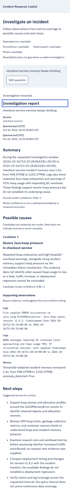
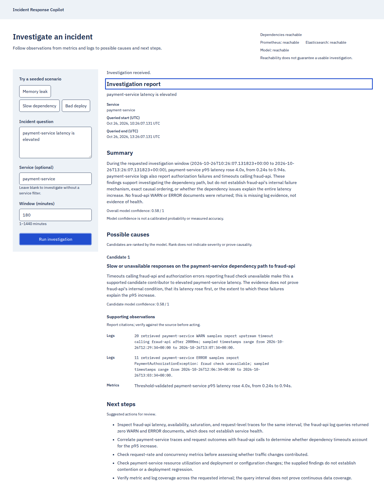
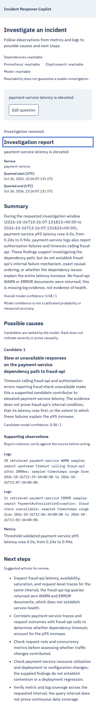
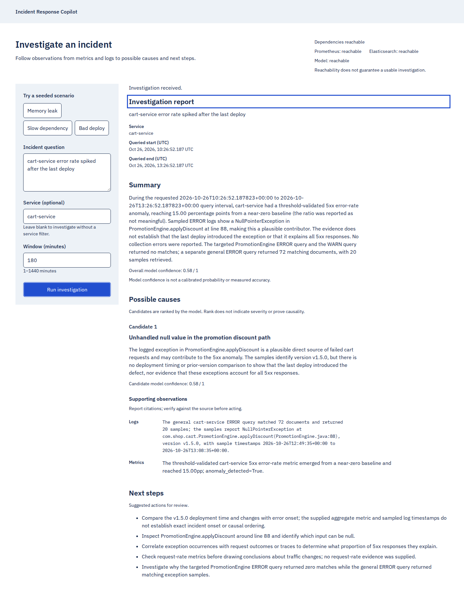
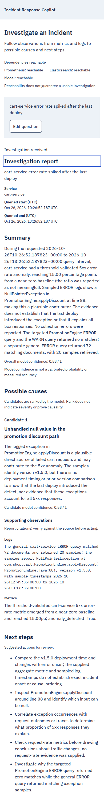

# Real investigation media — October 26, 2026

[Accessible video player and descriptive transcript](demo.html) ·
[55.6-second MP4](investigations.mp4) · [English captions](investigations.en.vtt)

These are three genuine browser → Next.js → FastAPI → OpenAI investigations of
synthetic incidents. Model: `gpt-6-luna`, reasoning `none`, tracing disabled.
Desktop viewport: 1440×1000; mobile viewport: 390×844. Full-page screenshots show
the same returned report at each width, without a second mobile model call.
No credentials, account interfaces or real customer telemetry were displayed.

| Scenario | HTTP request to response body | Click to report render | Visible report |
| --- | ---: | ---: | --- |
| Memory leak | 21.667 s | 21.712 s | Resident-memory growth and GC/OOM logs support heap pressure; its underlying mechanism remains unproven. |
| Slow dependency | 27.989 s | 28.034 s | Caller latency and timeouts name fraud-api; neither internal mechanism nor causal ordering is established. |
| Bad deploy | 19.037 s | 19.083 s | 5xx increase and PromotionEngine exceptions support a code-path hypothesis; deployment causality remains unproven. |

HTTP timing starts at the browser's request event and ends after JSON body
decoding. Click-to-render timing includes submit handling, HTTP and report
validation/render assertions. Navigation/setup and recording length are separate.
These are one call per scenario, excluded from the nine-attempt evaluation's
scores and direct-service latency statistics. They are not a repeated HTTP or
browser performance benchmark. The seed was loaded at 13:10 UTC; these calls
started between 13:25 and 13:27 UTC and used server-owned 180-minute windows.

The video joins original-speed excerpts from each recording: preset/submit,
then the returned summary, candidate observations and next steps. Most model
waiting and the final mobile resize are omitted. No report text was changed and
no response was substituted. Native captions can be toggled; there is no audio,
no autoplay and a full descriptive transcript in the player. Playback duration
must not be presented as investigation latency.

## Desktop and mobile screenshots

Memory pressure: the report cites resident-memory growth, five sampled Java
heap-space errors and 17 matching GC warnings; model confidence is uncalibrated.




Dependency: the report separates the payment-service symptom from fraud-api,
names the retrieved timeout messages and asks for dependency traces/metrics.





Application errors: the report distinguishes 72 matching ERROR documents from
20 retrieved samples, retains exception details and asks for deploy correlation.





## Provenance and reproduction

[Requests, reports, exact windows and timings](../../validation/2026-10-26-evaluation/browser-demo.json),
[cut intervals](../../validation/2026-10-26-evaluation/media-edits.json),
[browser capture](../../validation/2026-10-26-evaluation/browser-demo.mjs),
[editing command driver](../../validation/2026-10-26-evaluation/edit-demo.py),
and [local playback check](../../validation/2026-10-26-evaluation/check-media.mjs)
are retained. Original full recordings:
[memory](raw/memory_leak.webm), [dependency](raw/slow_dependency.webm),
[deploy](raw/bad_deploy.webm). Generated duplicate copies were removed only after
their SHA-256 matched a retained original.

From the repository root, with the deployed seeded stack running, deliberately
repeating `node docs/validation/2026-10-26-evaluation/browser-demo.mjs --live`
makes three additional paid calls and refuses to overwrite its JSON. Use fresh
artifact names/paths for a new session. Editing and checking saved media make
zero model calls:

```sh
.venv/bin/python docs/validation/2026-10-26-evaluation/edit-demo.py
node docs/validation/2026-10-26-evaluation/check-media.mjs
python -m http.server 8085 --bind 127.0.0.1 --directory docs/media/2026-10-26
# Open http://127.0.0.1:8085/demo.html
```

The dedicated check server supports HTTP byte ranges for seeking. Serve the
player over HTTP; opening a file URL can block caption loading. Hosts serving
the MP4 should support byte ranges. No hosting publication is part of this work.
